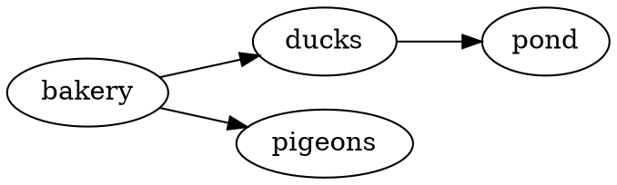

::examples
:::example{label="D2"}
````md
```d2 [How a sighting reaches the map]
phone -> api: POST /sightings
api -> queue: dedupe
queue -> map: pigeon pin
```
````
:::

:::example{label="Graphviz"}
````md

````
:::

:::example{label="ASCII"}
````md
```svgbob
  .-------.     .--------.
  | ducks |---->| census |
  '-------'     '--------'
```
````
:::
::

A diagram in a review shows what changed in a flow or a schema faster than prose. The plugin sends each diagram's source to a [Kroki](https://kroki.io) server while parsing and puts the SVG it draws in the page, after taking out anything that could run. **The diagram's source leaves your machine**: it goes to `kroki.io` unless you [run your own Kroki](/diagrams/guides/).
